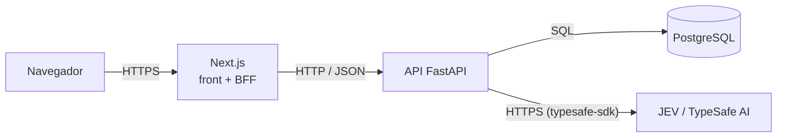
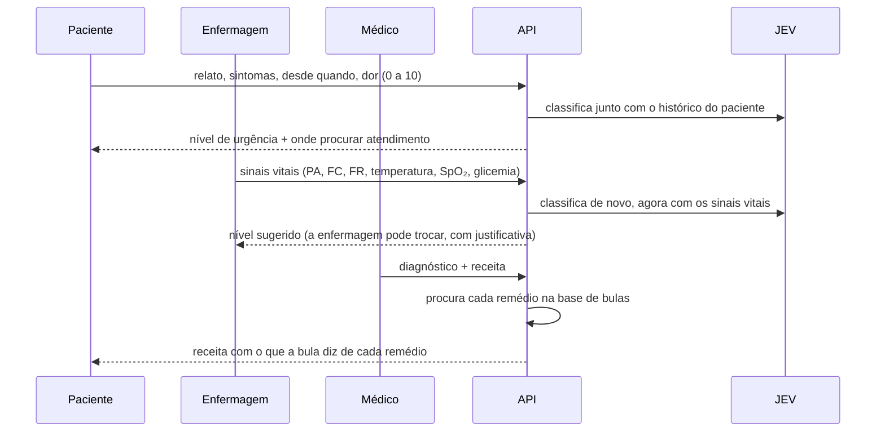

# TriIAge

Este é o repositório do meu TCC. O TriIAge é um sistema de apoio à **triagem de pacientes** que usa IA
(o modelo JEV, da TypeSafe AI) junto com uma **árvore de decisão** baseada nos fluxogramas do CAB 28 do
Ministério da Saúde. A ideia não é substituir a enfermagem nem o médico, e sim adiantar o trabalho: o
paciente conta o que está sentindo antes de chegar, o sistema sugere um nível de urgência e a equipe confirma
(ou corrige) com os sinais vitais.

Também tem uma parte de **pós-consulta**: quando o médico termina o atendimento e passa a receita, o paciente
consegue ver o que a bula diz de cada remédio.

> ⚠️ É um projeto acadêmico. Não usar com pacientes reais nem mandar dados reais de pacientes para o modelo
> externo. As bases de conhecimento foram montadas a partir de material público (Ministério da Saúde e bulas
> da Anvisa), mas não passaram por validação clínica formal.

---

## Sumário

- [Como o repositório está organizado](#como-o-repositório-está-organizado)
- [Arquitetura](#arquitetura)
- [Tecnologias](#tecnologias)
- [Como rodar](#como-rodar)
- [Contas de demonstração](#contas-de-demonstração)
- [O fluxo de um atendimento](#o-fluxo-de-um-atendimento)
- [Como a classificação funciona](#como-a-classificação-funciona)
- [Banco de dados](#banco-de-dados)
- [Testes](#testes)
- [Piloto de avaliação](#piloto-de-avaliação)
- [O que ainda falta](#o-que-ainda-falta)
- [Onde ler mais](#onde-ler-mais)

---

## Como o repositório está organizado

Resolvi deixar tudo num monorepo só, porque front e back mudam juntos quase sempre (se muda um schema no
Pydantic, tem que mudar o tipo no TypeScript) e fica mais fácil subir tudo com um comando.

```
TCC/
├── docker-compose.yml        # sobe banco + API + front de uma vez
├── .env.example              # variáveis do front usadas pelo compose da raiz
├── TriIAge-backend/          # API em Python (FastAPI + JEV + PostgreSQL)
│   ├── src/                  # código da API
│   ├── database/             # schema SQL, scripts de carga e os CSVs das bases
│   ├── tests/                # testes com pytest (sem gastar chamadas do JEV)
│   └── docs/                 # documentação detalhada do backend, capítulo por capítulo
├── TriIAge-main/
│   ├── web/                  # front-end + BFF em Next.js
│   └── TriIAge_Documento_de_Software_final_v1.docx   # documento de software (requisitos, casos de uso)
└── piloto/                   # scripts e resultados do piloto de avaliação do sistema
```

Cada subprojeto tem o próprio README com mais detalhe:
[backend](TriIAge-backend/README.md) · [front](TriIAge-main/web/README.md) · [piloto](piloto/LEIA-ME_piloto.md).

---

## Arquitetura



Algumas decisões que tomei e o porquê:

- **O navegador nunca fala direto com a API.** Ele fala com as rotas `/api` do Next.js (o BFF, "backend for
  frontend"), que conferem a sessão e o perfil do usuário e só aí repassam para a FastAPI. O id do usuário
  sempre sai da sessão, nunca do corpo da requisição, então um paciente não consegue abrir o atendimento de
  outro.
- **Só a API acessa o banco e o JEV.** A chave do JEV fica no servidor e nunca vai para o navegador.
- **A regra de triagem fica num lugar só (o backend).** Se um dia tiver um app de celular, ele usa a mesma API.
- **A triagem nunca trava por causa da IA.** Se o JEV cair ou demorar, a árvore de decisão classifica sozinha
  (mais sobre isso [aqui embaixo](#como-a-classificação-funciona)).

---

## Tecnologias

| Parte | O que usei |
|---|---|
| Backend | Python 3.14, FastAPI, Uvicorn, Pydantic, pydantic-settings, SQLAlchemy 2, psycopg2 |
| IA | JEV (TypeSafe AI) via `typesafe-sdk` |
| Banco | PostgreSQL 17 |
| Frontend | Next.js 16 (App Router), React 19, TypeScript, Tailwind CSS 4, NextAuth |
| Gerenciadores | `uv` no Python, `npm` no Node |
| Infra | Docker e Docker Compose |
| Testes | pytest + httpx |

Eu troquei o `pip` pelo `uv` no meio do projeto e não me arrependo: é bem mais rápido e as versões ficam
travadas no `uv.lock`, então todo mundo instala exatamente a mesma coisa.

---

## Como rodar

### Pré-requisitos

- [Docker Desktop](https://www.docker.com/products/docker-desktop/) (com o Docker Compose)
- Uma chave da API do JEV (`TYPESAFE_API_KEY`)
- Opcional, só se for rodar fora do Docker: Python 3.14 com [uv](https://docs.astral.sh/uv/) e Node 20+

### Jeito mais fácil: tudo no Docker

1. **Configurar o backend.** Copie o modelo e preencha a senha do banco e a `TYPESAFE_API_KEY`:

   ```bash
   cp TriIAge-backend/.env.example TriIAge-backend/.env
   ```

2. **Configurar o front.** Na raiz (pasta `TCC`), copie o modelo e preencha `NEXTAUTH_SECRET` e
   `AUTH_DEMO_PASSWORD`:

   ```bash
   cp .env.example .env
   ```

   Para gerar o `NEXTAUTH_SECRET`:

   ```bash
   node -e "console.log(require('crypto').randomBytes(32).toString('base64'))"
   ```

3. **Subir tudo:**

   ```bash
   docker compose up --build
   ```

   O compose espera o banco ficar pronto antes de subir a API, e a API ficar saudável antes de subir o front.

4. **Abrir:**

   | O quê | Onde |
   |---|---|
   | Sistema (front) | http://localhost:3000 |
   | API | http://localhost:8000 |
   | Documentação da API (Swagger) | http://localhost:8000/docs |
   | PostgreSQL | `localhost:5432` |

> **Pegadinha que me pegou várias vezes:** o banco só é criado e populado com os CSVs **na primeira vez**,
> quando o volume está vazio. Se você mudar algum CSV ou o schema, tem que apagar o volume:
>
> ```bash
> docker compose down -v && docker compose up --build
> ```

### Rodando as partes separadas (para desenvolver)

Quando estou mexendo só em uma parte, prefiro rodar ela fora do Docker para ter hot reload.

**Backend** (de dentro de `TriIAge-backend/`):

```bash
docker compose up db          # sobe só o banco
uv sync                       # instala as dependências
uv run uvicorn src.main:app --reload
```

**Frontend** (de dentro de `TriIAge-main/web/`, com a API já no ar):

```bash
cp .env.example .env.local    # preencha NEXTAUTH_SECRET e AUTH_DEMO_PASSWORD
npm install
npm run dev                   # http://localhost:3000
```

---

## Contas de demonstração

O script `TriIAge-backend/database/init/03_demo_data.sql` cria uma equipe fictícia e uma paciente de exemplo,
a **Maria Aparecida Souza** (hipertensa, alérgica a dipirona, com medições de pressão feitas em casa e um
atendimento antigo já finalizado, inclusive com uma retriagem porque a febre subiu enquanto ela esperava).

Todas as contas usam a senha que você colocou em `AUTH_DEMO_PASSWORD`:

| E-mail | Perfil | O que consegue fazer |
|---|---|---|
| `paciente@triiage.local` | Paciente | Nova avaliação, ver os próprios atendimentos e receitas, completar o histórico |
| `recepcao@triiage.local` | Recepção | Ver a fila de triagem (só leitura) |
| `enfermagem@triiage.local` | Enfermagem | Fila de triagem, triagem com sinais vitais e retriagem |
| `medico@triiage.local` | Médico(a) | Consultas: diagnóstico, receita e recomendações |
| `auditoria@triiage.local` | Auditoria | Logs de auditoria *(tela planejada)* |
| `gestao@triiage.local` | Gestão clínica | Governança do modelo *(tela planejada)* |

Os perfis e o que cada um acessa estão em [roles.ts](TriIAge-main/web/src/lib/roles.ts). O
[proxy.ts](TriIAge-main/web/src/proxy.ts) bloqueia quem tenta abrir uma página fora do próprio perfil.

---

## O fluxo de um atendimento



1. **Paciente** (`/avaliacao`) conta o que está sentindo. A API junta o relato com o histórico dele (idade,
   sexo, doenças, alergias, remédios em uso) e devolve o nível de urgência, onde procurar atendimento e os
   sinais de alerta. O atendimento vai para a fila da enfermagem.
2. **Enfermagem** (`/fila`) vê os pacientes ordenados por gravidade e completa com os sinais vitais. O sistema
   classifica de novo. Se a enfermagem discordar, pode escolher outro nível, mas aí a justificativa é
   obrigatória. Enquanto o médico não atende, dá para fazer uma **retriagem** (por exemplo, se o paciente
   piorou na espera). As triagens antigas ficam guardadas, nada é sobrescrito.
3. **Médico** (`/consultas`) vê tudo (relato, triagens, classificações, histórico) e registra diagnóstico,
   receita e recomendações. O atendimento é finalizado e o diagnóstico e os remédios entram no histórico.
4. **Paciente** (`/atendimentos/[id]`) acompanha as etapas e, no fim, vê a receita com o detalhe de cada
   remédio. Em `/historico` ficam sinais vitais, remédios, doenças, alergias, cirurgias e atendimentos.

O front tem tela inicial diferente para cada perfil, tema claro e escuro, e funciona no celular (abaixo de
768 px o menu vira hambúrguer e as tabelas viram cartões). A sessão expira depois de 15 minutos sem
atividade.

---

## Como a classificação funciona

Essa foi a parte que mais me deu trabalho, então vale explicar. A classificação usa um **motor híbrido**:
duas coisas classificam o mesmo caso e o sistema fica com a mais segura.

**1. O JEV.** Ele não escreve texto livre como um chatbot: a gente manda os dados do paciente e uma pergunta
de múltipla escolha, e ele devolve qual opção escolheu e a probabilidade de cada uma. Antes de perguntar, a
API faz uma busca simples por palavras na base (81 situações clínicas) e manda só as queixas mais parecidas,
com todas as faixas de gravidade delas. Sempre tem a opção "nenhuma corresponde", para o modelo poder dizer
que não sabe em vez de chutar.

**2. A árvore de decisão.** Segue o formato dos fluxogramas do CAB 28: acha a queixa principal e desce pelas
faixas, da mais grave para a mais leve, parando na primeira que tem um **discriminador** no relato (por
exemplo, "febre alta"). Sinais vitais muito alterados garantem um nível mínimo (SpO₂ < 90 vira emergência,
por exemplo). Ela também ignora o que vem depois de "sem" ou "não", e desconsidera o que a medição desmente
("febre alta" com temperatura normal não conta).

**As regras de segurança por cima disso:**

- **Escalonamento:** se uma faixa mais grave teve 20% de probabilidade ou mais no JEV, ela ganha. Prefiro
  errar para o lado mais seguro.
- **Divergência:** se a árvore e o JEV discordarem, fica o nível **mais urgente** e o caso é marcado com
  `divergent: true`.
- **Revisão humana:** se a confiança do modelo ficar abaixo de `MIN_CONFIDENCE` (0,7 por padrão), o caso é
  marcado com `needs_human_review: true`.
- **Contingência:** se o JEV falhar ou passar de `JEV_TIMEOUT` segundos (10 por padrão), vale só a árvore
  (`origin: "rules"`). A triagem nunca fica parada esperando a IA.
- **Sem correspondência:** se nada na base bater com o relato, o sistema diz que não tem informação
  suficiente e orienta procurar um profissional. Não tenta adivinhar.

Os níveis seguem as cores de sempre da classificação de risco:

| Nível | Cor | Significado |
|---|---|---|
| 1 | 🔴 Vermelho | Emergência |
| 2 | 🟠 Laranja | Muito urgente |
| 3 | 🟡 Amarelo | Urgente |
| 4 | 🟢 Verde | Pouco urgente |
| 5 | 🔵 Azul | Não urgente |

Na **pós-consulta**, para cada remédio da receita a API procura pelo princípio ativo, nome ou marca
("Sertralina 50mg" acha o "cloridrato de sertralina"). Se não achar (erro de digitação, marca diferente),
pergunta ao JEV qual remédio da base é aquele. Só aceita se a confiança for alta; senão volta
`found: false`. A resposta nunca fala de dose nem do motivo de o médico ter receitado.

A explicação completa, com código, está em [docs/05-jev.md](TriIAge-backend/docs/05-jev.md).

---

## Banco de dados

O schema está em [01_schema.sql](TriIAge-backend/database/init/01_schema.sql). Dividindo por assunto:

| Grupo | Tabelas |
|---|---|
| Bases de conhecimento | `symptom_urgency` (81 situações clínicas), `medications` (90 medicamentos) |
| Usuários e pacientes | `users`, `patients`, `health_records`, `patient_medications` |
| Atendimento | `encounters`, `classifications`, `vital_signs`, `triages` |
| Receita | `prescriptions`, `prescription_items` |

As duas bases de conhecimento vêm dos CSVs em [database/csv/](TriIAge-backend/database/csv/) e são
carregadas pelo `02_seed.sh` quando o banco é criado. Cada linha tem a fonte (publicação do Ministério da
Saúde ou bula da Anvisa) e a data de referência.

Cada classificação fica salva em `classifications` (a pré-análise do paciente e uma por triagem), com o que
foi mandado para o JEV guardado em `JSONB`. Assim dá para comparar depois o que a IA sugeriu com o que a
enfermagem decidiu.

---

## Testes

Os testes do backend não chamam o JEV de verdade: o `tests/conftest.py` tem um `FakeJev` que imita o cliente
e responde o que o teste mandar. Mas eles usam os CSVs reais, então conferem a busca, a árvore, o
escalonamento e os casos sem correspondência sem internet e sem custo.

```bash
cd TriIAge-backend
uv run pytest -v
```

São 42 testes, divididos em árvore de decisão, motor híbrido, triagem, atendimentos e medicamentos.

No front, por enquanto só tem o lint:

```bash
cd TriIAge-main/web
npm run lint
```

---

## Piloto de avaliação

A pasta [piloto/](piloto/) tem os scripts que usei para medir o desempenho do sistema para o artigo. Eles
comparam quatro configurações no mesmo conjunto de casos:

| Config. | O que roda |
|---|---|
| A | Só a árvore de decisão |
| B | Só o JEV, escolhendo entre todas as situações da base |
| C | O motor híbrido, que é o que a API usa de verdade |
| D | Linha de base: sempre o nível mais frequente |

As métricas são cobertura, kappa ponderado (com intervalo de confiança por bootstrap), acurácia, subtriagem e
sobretriagem, sensibilidade e especificidade para casos urgentes e tempo de resposta. O `gerar_relatorio.py`
monta o relatório em Word direto dos resultados, sem nenhum número digitado à mão.

> A rodada que está no repositório usou **100 casos sintéticos** escritos com ajuda de IA, com a referência
> definida pelos critérios do CAB 28/Manchester, mas **ainda não validada por enfermeiros**. Os resultados
> servem para testar o processo, não para tirar conclusão clínica.

O passo a passo completo está no [LEIA-ME do piloto](piloto/LEIA-ME_piloto.md).

---

## O que ainda falta

Coisas que eu sei que não estão prontas:

- As telas de **auditoria** e **governança do modelo** estão só planejadas; dependem de endpoints novos na API.
- As faixas de alerta dos sinais vitais no front ([vital-signs.ts](TriIAge-main/web/src/lib/vital-signs.ts))
  são provisórias, até a API expor essas faixas.
- A base tem poucas situações de nível 4 e 5, e as de nível 5 são complementares do projeto, pendentes de
  validação. Queixas fora da base (trauma, torção, corte...) tendem a ficar sem nível.
- O login é de demonstração (uma senha só para todas as contas). Para uso real precisaria de autenticação
  de verdade.
- Os casos do piloto precisam ser rotulados por enfermeiros, o que envolve passar pelo comitê de ética.
- O front não tem testes automatizados.

---

## Onde ler mais

- **Backend, capítulo por capítulo:** [TriIAge-backend/docs/](TriIAge-backend/docs/README.md) — visão geral,
  tecnologias, Docker, banco, JEV, Swagger e um passo a passo do zero.
- **Front:** [TriIAge-main/web/README.md](TriIAge-main/web/README.md) — estrutura de pastas, BFF, temas.
- **Endpoints:** a tabela completa está no [README do backend](TriIAge-backend/README.md#endpoints), ou
  abra http://localhost:8000/docs com a API rodando.
- **Requisitos e casos de uso:** o documento de software em `TriIAge-main/`.
