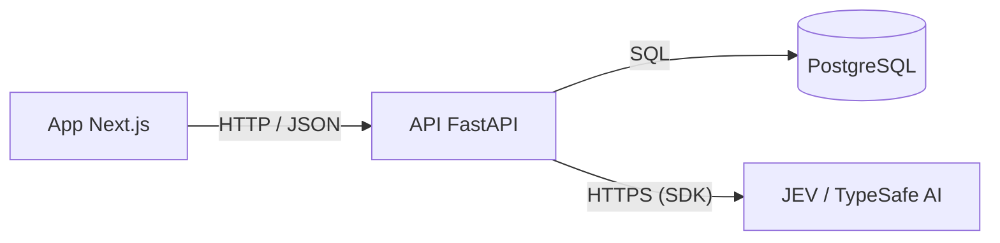
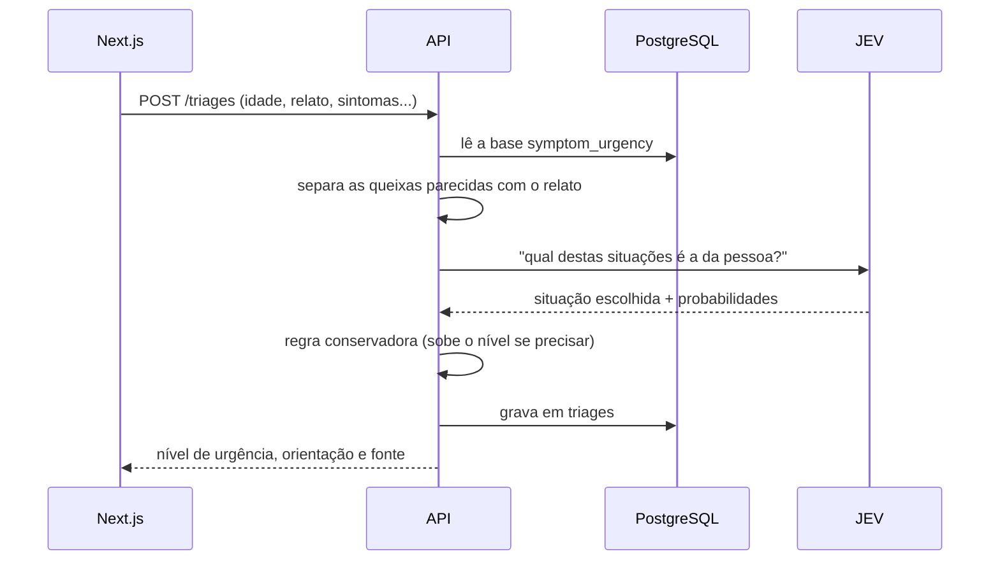

# 1. Visão geral

O backend é um microsserviço em Python que fica entre o app em Next.js e o JEV, um modelo de IA da TypeSafe
AI. Ele atende dois momentos do atendimento:

- **Pré-consulta:** a pessoa conta o que está sentindo e recebe um nível de urgência e uma orientação de
  quando e onde procurar atendimento.
- **Pós-consulta:** a pessoa informa os medicamentos que recebeu na receita e vê, para cada um, para que
  condições a bula prevê indicação.

Nos dois casos o JEV não "inventa" a resposta. Ele escolhe entre opções que estão nas nossas bases de
conhecimento, que montamos a partir de publicações do Ministério da Saúde e de bulas aprovadas pela Anvisa.
A resposta sempre volta com a fonte.

## Por que um serviço separado do frontend

No começo pensamos em deixar tudo no Next.js, mas separar fez mais sentido:

- a regra de triagem fica num lugar só, e se mudar não precisa mexer no front;
- a chave do JEV fica no servidor e nunca vai para o navegador;
- se um dia tiver um app mobile, ele usa a mesma API;
- dá para escalar só essa parte se ela ficar pesada.

## As peças

A API e o banco rodam em containers Docker na nossa máquina. O JEV é um serviço externo, acessado pela
internet com a SDK `typesafe-sdk`.

## O caminho de uma triagem

1. O Pydantic valida o JSON. Idade negativa, por exemplo, já volta com erro `422`.
2. A API procura na base as queixas parecidas com o relato (busca simples por palavras) e pega todas as
   faixas de gravidade delas. Para "dor no peito com falta de ar", vêm as faixas de dor no peito e de falta
   de ar.
3. Essas faixas vão para o JEV como opções, junto com os dados da pessoa. Ele escolhe uma, ou diz que
   nenhuma serve.
4. Se uma faixa mais grave também parecer plausível, ela ganha. Preferimos errar para o lado mais seguro.
5. A triagem fica salva na tabela `triages`.
6. Se nada na base bater com o relato, a resposta diz que não temos informação suficiente e orienta procurar
   um profissional. Não tentamos adivinhar.

## O caminho de uma consulta de medicamentos

1. O front manda a lista, por exemplo `["Dipirona 1g", "Losartana 50mg"]`.
2. Para cada nome, a API tenta achar o medicamento pelo princípio ativo, pelo nome ou pela marca.
3. Se não achar (erro de digitação, marca que não está na base), ela pergunta ao JEV qual item da base
   corresponde ao nome.
4. Volta o detalhamento: indicações em bula, condições relacionadas, como o remédio age, contraindicações,
   advertências e a bula usada. Se não houver correspondência confiável, volta `found: false`.

A resposta nunca diz por que o médico receitou o remédio, nem fala de dose.

## Onde está cada coisa

| Arquivo | O que tem |
|---|---|
| `src/main.py` | cria o app, liga o CORS e abre o cliente do JEV |
| `src/core/config.py` | lê as configurações do `.env` |
| `src/db/models.py` | as tabelas como classes Python |
| `src/schemas.py` | o formato do JSON de entrada e de saída |
| `src/services/triage.py` | regra da pré-consulta |
| `src/services/medications.py` | regra da pós-consulta |
| `src/services/text.py` | normalização de texto usada nas buscas |
| `src/api/routes.py` | os endpoints |

Os arquivos de `services/` não sabem nada de HTTP nem de banco: recebem os dados e devolvem um resultado.
Por isso dá para testar a regra trocando o JEV por um falso (ver `tests/`).
