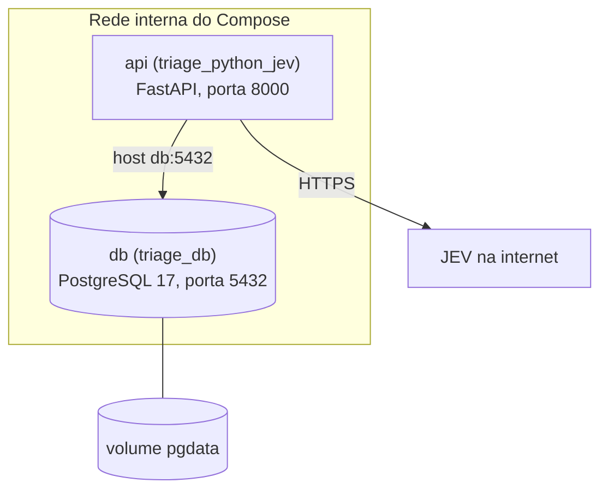

# 3. Docker

Sem Docker, cada pessoa do grupo teria que instalar Python 3.14 e PostgreSQL, criar usuário e banco, criar as
tabelas e carregar os dados na mão. Com Docker, cada parte roda num container que já leva tudo o que precisa,
e o projeto inteiro sobe com um comando:

```
docker compose up --build
```

Outras vantagens que sentimos na prática: o banco é descartável (dá para apagar e recriar já com os dados em
segundos), nada fica instalado no Windows e a mesma imagem pode ir para um servidor depois.

Dois termos que confundem no começo: a **imagem** é a receita pronta (ex.: `postgres:17`) e o **container**
é essa imagem rodando.

## Dockerfile (imagem da API)

```dockerfile
FROM python:3.14-slim                          # Linux enxuto com Python
COPY --from=ghcr.io/astral-sh/uv:0.11.15 ...   # traz o uv
COPY pyproject.toml uv.lock ./                 # só a lista de dependências
RUN uv sync --locked --no-dev ...              # instala as dependências
COPY src ./src                                 # o código
CMD ["uvicorn", "src.main:app", ...]           # comando ao iniciar
```

As dependências são copiadas antes do código de propósito. O Docker guarda cada passo em cache; como o código
muda toda hora e as dependências quase nunca, o rebuild só refaz a cópia do código.

O ambiente virtual fica em `/opt/venv`, fora da pasta do app. No desenvolvimento a pasta `src/` do nosso PC é
espelhada dentro do container, e se a `.venv` ficasse junto, a do Windows atrapalharia a do Linux.

O `.dockerignore` deixa de fora da imagem o `.env`, a `.venv` e o `.git`, para a senha não ir parar dentro
da imagem.

## docker-compose.yml

O Compose sobe os dois serviços juntos e numa rede interna:



No serviço **db**:

- `image: postgres:17` usa a imagem oficial;
- o volume `pgdata` guarda os dados, que sobrevivem mesmo se o container for apagado;
- `./database/init` é montado em `/docker-entrypoint-initdb.d`. O Postgres roda esses scripts só na primeira
  vez, com o volume vazio: um cria as tabelas e o outro carrega os CSVs;
- `./database/csv` aparece dentro do container como `/seed`;
- o `healthcheck` pergunta ao Postgres a cada 5 segundos se ele já está pronto.

No serviço **api**:

- `build: .` constrói a imagem pelo nosso Dockerfile;
- `env_file: .env` passa as variáveis do `.env`;
- `POSTGRES_HOST: db`: dentro da rede do Compose, cada serviço é achado pelo nome. Para a API, `localhost`
  seria ela mesma;
- `depends_on` com `service_healthy` faz a API esperar o banco ficar pronto;
- `--reload` e o volume `./src:/app/src` são para desenvolvimento: salvou um arquivo, a API reinicia.

Um detalhe que demorou para entender: o healthcheck usa `pg_isready -h 127.0.0.1`. Na primeira subida, o
Postgres roda os scripts de carga num servidor temporário que só aceita conexão local pelo socket. Testando
pela rede, ele só fica "saudável" depois que os CSVs já entraram, e a API nunca pega o banco pela metade.

## Comandos do dia a dia

| Comando | O que faz |
|---|---|
| `docker compose up --build` | constrói a imagem e sobe tudo |
| `docker compose up -d` | sobe em segundo plano |
| `docker compose ps` | mostra os containers e o estado |
| `docker compose logs -f api` | acompanha os logs da API |
| `docker compose down` | para tudo, mas mantém os dados |
| `docker compose down -v` | para tudo e apaga o banco (na próxima subida ele é recriado pelos CSVs) |
