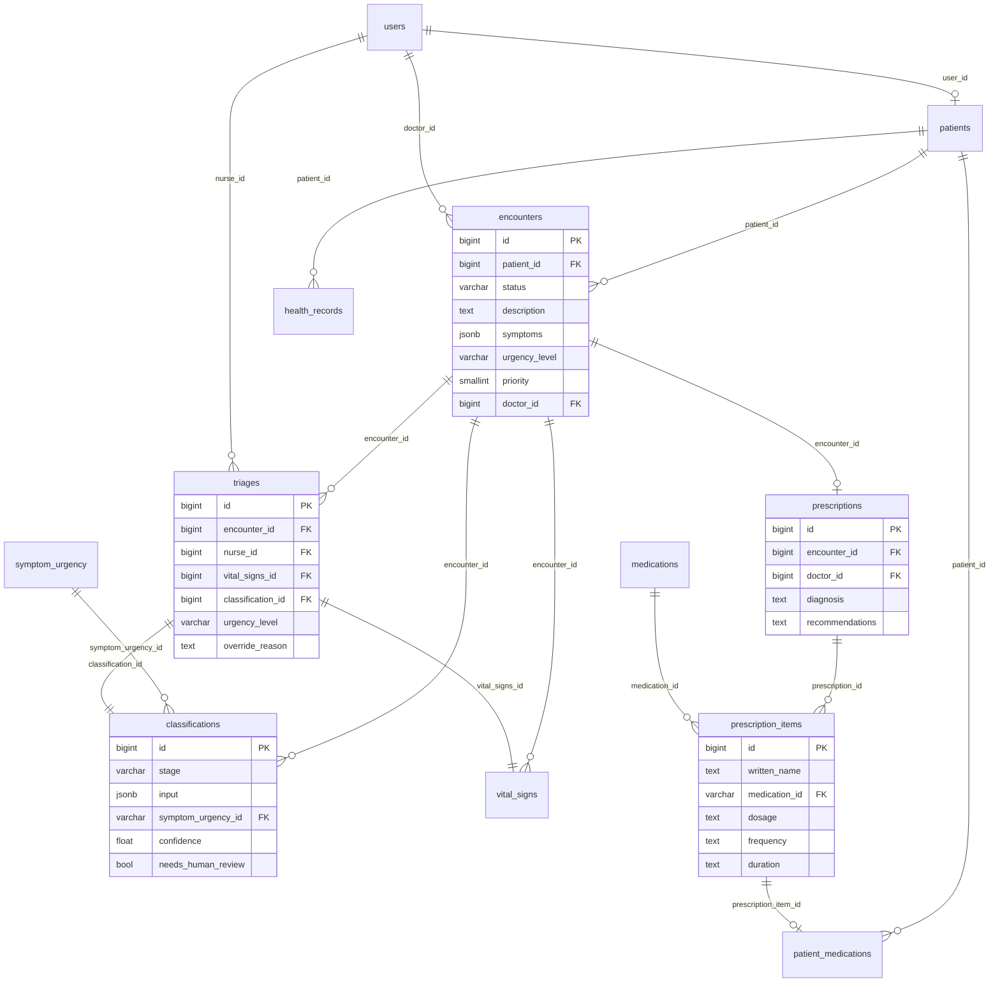

# 4. Banco de dados e bases de conhecimento

O banco tem dois grupos de tabelas. Duas são as bases de conhecimento do JEV, que vêm de CSV. As outras
guardam o atendimento: quem é o paciente, o que ele contou, o que a enfermagem mediu e a receita do médico.
A estrutura está em `database/init/01_schema.sql` e os dados de exemplo em `database/init/03_demo_data.sql`.

| Tabela | De onde vem | O que guarda |
|---|---|---|
| `symptom_urgency` | `database/csv/symptom_urgency.csv` | situações clínicas e o nível de urgência de cada uma (81 linhas, 26 queixas; 8 são faixas complementares do projeto, de nível 4 e 5, com `source` começando por "Critério do projeto TriIAge" e pendentes de validação clínica) |
| `medications` | `database/csv/medications.csv` | medicamentos e as indicações previstas em bula (90) |
| `users` | API / dados de exemplo | pacientes e equipe; o campo `role` diz o perfil |
| `patients` | API / dados de exemplo | dados do paciente: nascimento, sexo, tipo sanguíneo |
| `encounters` | API | o atendimento: relato do paciente, nível atual (o da última triagem), médico e status |
| `classifications` | API | cada classificação do motor híbrido (pré-análise e cada triagem): nível final, níveis do JEV e da árvore, divergência, origem (`hybrid` ou `rules`), caminho da árvore e tempo |
| `triages` | API | cada triagem da enfermagem (a primeira e as retriagens): sinais vitais, classificação, nível que valeu, justificativa |
| `vital_signs` | API | medições da enfermagem (com `encounter_id`) ou feitas pelo paciente em casa |
| `prescriptions` / `prescription_items` | API | diagnóstico e receita; cada remédio aponta para a bula quando a gente acha |
| `health_records` | API | doenças, alergias e cirurgias do paciente (o diagnóstico da consulta entra aqui) |
| `patient_medications` | API | remédios que o paciente toma ou tomou, com intervalo e período |

O atendimento passa por três status: `waiting_nurse` (paciente mandou os sintomas) → `waiting_doctor`
(enfermagem mediu os sinais vitais) → `completed` (médico fez o diagnóstico e a receita). Em `waiting_doctor`
a enfermagem ainda pode fazer retriagens; cada uma vira uma linha nova em `triages`.



Como as tabelas são criadas pelos scripts de `database/init` só quando o volume está vazio, depois de mudar o
schema é preciso recriar o banco: `docker compose down -v && docker compose up --build`.

## Formato dos CSVs

- UTF-8, separador vírgula e aspas duplas quando o texto tem vírgula.
- Nomes de colunas e códigos em inglês; os textos clínicos ficaram em português, porque é isso que o paciente
  lê.
- Quando um campo tem vários valores, eles vêm separados por `|`, por exemplo `dor|febre`. No PostgreSQL dá
  para virar lista com `string_to_array(related_conditions, '|')`, e a API já devolve como lista JSON.
- Campo vazio quer dizer que a fonte não trazia aquela informação. Nada foi preenchido no chute.
- `reference_date` é o dia em que o registro foi conferido na fonte.

## symptom_urgency (pré-consulta)

Cada queixa (`main_symptom`) aparece em várias linhas, uma por faixa de gravidade. "Dor no peito", por
exemplo, tem uma linha de emergência, uma de muito urgente e uma de urgente, cada uma com a sua descrição.

| Coluna | O que é |
|---|---|
| `id` | identificador, `SYM-0001` |
| `main_symptom`, `associated_symptoms` | queixa principal e sintomas que costumam vir junto |
| `description` | o quadro que define aquela faixa |
| `warning_signs`, `aggravating_factors` | sinais de alerta e agravantes citados pela fonte |
| `risk_groups`, `age_groups` | grupos de risco e faixas etárias (`all`, `under_2_months`, `child`, `adolescent`, `adult`, `elderly`) |
| `urgency_level`, `priority` | nível e prioridade (tabela abaixo) |
| `guidance`, `care_timeframe` | orientação ao paciente e prazo de atendimento |
| `clinical_rationale` | por que aquela faixa tem aquele nível |
| `source`, `source_url` | documento, página e link |

| `urgency_level` | `priority` | Orientação |
|---|---|---|
| `emergency` | 1 | ligar para o SAMU 192 |
| `very_urgent` | 2 | ir a um pronto atendimento imediatamente |
| `urgent` | 3 | avaliação médica no mesmo dia |
| `less_urgent` | 4 | consulta agendada |
| `guided_self_care` | 5 | cuidados em casa, com critérios de quando procurar atendimento |

As fontes são todas do Ministério da Saúde:

- *Acolhimento à demanda espontânea: queixas mais comuns na Atenção Básica* (Cadernos de Atenção Básica nº 28,
  v. II, 2013). Rendeu 63 registros, tirados dos fluxogramas de classificação de risco de 16 queixas. As faixas
  do Caderno viraram níveis assim: atendimento imediato = `emergency`, prioritário = `very_urgent`, no dia =
  `urgent`, intervenção programada = `less_urgent`.
- *Dengue: diagnóstico e manejo clínico – adulto e criança* (6ª ed., 2024): 4 registros, um por grupo (A a D).
- *Caderneta da Gestante* (8ª ed. revisada, 2024): 6 registros com os sinais de alerta na gestação.

A regra que seguimos foi ser conservador: diante de sinal de alerta, informação insuficiente ou grupo de
risco, o nível sobe e nunca desce. Por isso nenhum registro ficou como `guided_self_care`, já que as fontes
não falam de cuidado em casa sem avaliação para essas queixas.

## medications (pós-consulta)

| Coluna | O que é |
|---|---|
| `id` | identificador, `MED-0001` |
| `name`, `active_ingredient`, `brand_names` | nome, princípio ativo e marcas que aparecem na bula usada |
| `pharmacological_class` | classe terapêutica |
| `therapeutic_indications`, `related_conditions` | indicações da seção "1. Indicações" da bula e termos curtos derivados delas |
| `indication_description` | explicação em linguagem simples, sempre começando por "A bula indica" |
| `mechanism_of_action` | como o remédio age, segundo a bula |
| `dosage_form`, `administration_routes` | forma, concentração e via da bula usada |
| `contraindications`, `warnings`, `age_range` | principais contraindicações, advertências e o que a bula diz sobre idade |
| `leaflet_source`, `source_url` | bula consultada (laboratório e data de aprovação) e link do PDF |

As bulas são as aprovadas pela Anvisa, quase sempre a versão para profissional de saúde, baixadas em PDF do
site do laboratório ou de sites que guardam o PDF original. O bulário da própria Anvisa bloqueia acesso
automatizado, então não usamos. A cobertura é de 90 registros: analgésicos e anti-inflamatórios,
antibióticos, anti-histamínicos e corticoides, gastrointestinais e antieméticos, broncodilatadores,
antidepressivos, anti-hipertensivos, antidiabéticos e alguns outros de uso frequente.

Cada linha vale para a apresentação da bula consultada. Quando as indicações mudam com a concentração, como
no pantoprazol 20 mg e 40 mg, são duas linhas. Não registramos doses em nenhum campo.

## Como os dados foram conferidos

Para cada medicamento e para os registros de dengue e gestação, o trecho que sustenta o registro foi
procurado palavra por palavra no texto extraído do PDF. Também conferimos campos obrigatórios, IDs únicos,
duplicatas e a ausência de posologia. Os fluxogramas do Caderno nº 28 estão em imagem no PDF, então esses 63
registros foram transcritos olhando a página, que fica citada em `source`. É a parte que mais pede revisão
de alguém da área da saúde.

## Como o banco nasce populado

Na primeira subida, com o volume vazio, o Postgres roda em ordem alfabética os arquivos de
`/docker-entrypoint-initdb.d`. Nós montamos `database/init/` ali:

1. `01_schema.sql` cria as tabelas;
2. `02_seed.sh` percorre `database/csv/*.csv` e carrega cada arquivo na tabela de mesmo nome com `\copy`, que
   é bem mais rápido que um `INSERT` por linha.

Pensando como engenharia de dados, é um pequeno pipeline de carga. O nome do arquivo precisa ser igual ao da
tabela, e a primeira linha do CSV tem que ser o cabeçalho com os nomes das colunas.

Os scripts só rodam com o volume vazio. Mudou um CSV ou o schema? Rode `docker compose down -v` e suba de
novo (isso apaga também as triagens gravadas). No Windows, confira que o `02_seed.sh` está com quebra de linha
LF; com CRLF o script não roda.

## Atualizando as bases

1. Pegue o documento oficial ou a bula em PDF e extraia o texto (`pdftotext -enc UTF-8 -layout`).
2. Adicione a linha com um `id` novo, a fonte e a `reference_date` do dia. Confira que o trecho que sustenta o
   registro está mesmo na fonte e que nenhum campo traz dose.
3. Se mudar colunas, ajuste também `01_schema.sql` e `src/db/models.py`.
4. Recrie o banco com `docker compose down -v && docker compose up --build`.

Para carregar em outro PostgreSQL, depois de criar as tabelas:

```sql
\copy symptom_urgency FROM 'symptom_urgency.csv' WITH (FORMAT csv, HEADER true, ENCODING 'UTF8')
\copy medications FROM 'medications.csv' WITH (FORMAT csv, HEADER true, ENCODING 'UTF8')
```

## Limitações que conhecemos

- Não achar um sintoma ou remédio na base não quer dizer que não há risco ou indicação. A API responde que
  não tem informação suficiente.
- Ainda faltam algumas queixas (tontura, urgências odontológicas e oftalmológicas, AVC, sinais de perigo na
  criança) e alguns remédios (espironolactona, furosemida, estatinas, AAS 100 mg, clopidogrel, varfarina).
- O Caderno nº 28 é de 2013 e foi escrito para a Atenção Básica.
- Algumas bulas não trazem a data de aprovação, só o histórico de alterações. Isso está anotado em
  `leaflet_source`.
